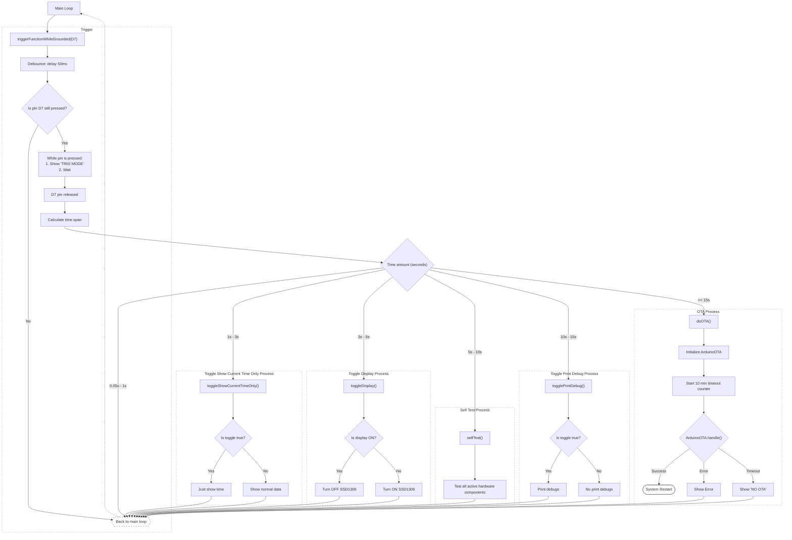

# esp8266-iot-gas-detector

<!--TOC-->

- [esp8266-iot-gas-detector](#esp8266-iot-gas-detector)
  - [Boards](#boards)
    - [ESP8266 D1 mini](#esp8266-d1-mini)
      - [Electric schema \[^1\]](#electric-schema-1)
    - [ESP32](#esp32)
      - [Initial testing](#initial-testing)
  - [Pin triggers](#pin-triggers)
  - [Power usage](#power-usage)
  - [Deployment \[^1\]](#deployment-1)
    - [Libraries](#libraries)
    - [IDE Setup](#ide-setup)
    - [Update `sketch.yml` file](#update-sketchyml-file)
    - [USB modem setup](#usb-modem-setup)
      - [Debian GNU/Linux 13](#debian-gnulinux-13)
    - [Secrets file](#secrets-file)
    - [Home Assistant setup](#home-assistant-setup)
  - [Version](#version)
  - [License](#license)
  - [Footnotes](#footnotes)

<!--TOC-->

## Boards

### ESP8266 D1 mini

#### Electric schema [^1]


### ESP32

#### Initial testing

| GPIO id | Usage |
|---------|-------|
| 19      | DHT 11 |
| 21      | SDA   |
| 22      | SCL   |

#### Electric schema [^1]

Download this
[ESP 32 D1 mini KiCad Footprint](https://github.com/besi/kicad-esp32-wemos-d1-mini)
and import it in KiCad.

## Pin triggers

To trigger these functions, use `BUTTON_A`:



## Power usage

| Components | mA   |
|------------|-----:|
| All        | 165  |
| DS3231     | 7    |
| DHT11      | 2    |
| SSD1306    | 5    |
| MQ-2       | 133  |

## Deployment [^1]

### Libraries

All these libraries are required as dependencies and can be installed via the
Arduino IDE:

| Library name | Author |
|--------------|--------|
| [Time](https://github.com/paulstoffregen/time) | [Michael Margolis](https://playground.arduino.cc/Code/Time/)
| [Adafruit SSD1306](https://github.com/adafruit/Adafruit_SSD1306) | [Adafruit](https://www.adafruit.com/) |
| [DHT sensor library](https://github.com/adafruit/DHT-sensor-library) | [Adafruit](https://www.adafruit.com/) |
| [ArduinoJson](https://arduinojson.org) | [Benoît Blanchon](https://github.com/bblanchon) |
| [WiFiManager](https://github.com/tzapu/WiFiManager) | [tzapu](https://github.com/tzapu/) |
| [RTCLib](https://github.com/adafruit/RTClib) | [Adafruit](https://www.adafruit.com/) |
| [Uptime-Library](https://github.com/YiannisBourkelis/Uptime-Library) | [Yiannis Bourkelis](https://github.com/YiannisBourkelis) |
| [AUnit](https://github.com/bxparks/AUnit) | [Brian Park](https://github.com/bxparks) |

### IDE Setup

This project is designed to be used with an ESP8266 board.
Follow [these](https://arduino-esp8266.readthedocs.io/en/latest/installing.html)
instructions to set it up.

### Update `sketch.yml` file

1. [install arduino-cli](https://arduino.github.io/arduino-cli/1.4/installation/)
2. compile the project and dump the profile

   ```shell
   make generate-sketch-project-file
   ```

### USB modem setup

#### Debian GNU/Linux 13

1. add your user to the dialout group

   ```shell
   sudo usermod -a -G dialout $USER
   ```

2. reboot

### Secrets file

Copy the `arduino_secrets.example.h` as `arduino_secrets.h` and change it to
your needs.

### Home Assistant setup

The firmware, starting from version `0.12.0`, is Home Assistant ready. You just
need to define how and what needs to be extracted and formatted from the JSON
payload.

1. generate a new `Long-lived access token`:
   1. Profile
   2. Security
   3. Long-lived access tokens
   4. Create token
   5. copy the generated token in the `Config::Network::AUTHORIZATION_BEARER_TOKEN`
      configuration variable
2. use this template in the `configuration.yml` file or change it to your liking

   ```yaml
   template:
     - trigger:
       - platform: event
         event_type: "sensore_esp_unificato"
       sensor:
         - name: "ESP Temperatura"
           unique_id: "esp_temp"
           state: >
             
             
               {{ "%.2f" | format(data.sensors.temperature_celsius | float(0.0)) }}
             
               {{ none }}
             

           unit_of_measurement: "°C"
           device_class: temperature
           attributes: &esp_metadata
             board_id: "{{ trigger.event.data.board.id if trigger.event.data is defined else 'N/A' }}"
             sw_version: "{{ trigger.event.data.version.sw if trigger.event.data is defined else 'N/A' }}"
             hw_rev: "{{ trigger.event.data.version.hw if trigger.event.data is defined else 'N/A' }}"

         - name: "ESP Umidità"
           unique_id: "esp_hum"
           state: >
             
             
               {{ "%.2f" | format(data.sensors.humidity_percent | float(0.0)) }}
             
               {{ none }}
             
           unit_of_measurement: "%"
           device_class: humidity
           attributes: *esp_metadata

         - name: "ESP Gas Voltaggio"
           unique_id: "esp_gas_volts"
           state: >
             
             
               {{ "%.6f" | format(data.sensors.gas_concentration_volts | float(0.0)) }}
             
               {{ none }}
             
           unit_of_measurement: "V"
           device_class: voltage
           attributes: *esp_metadata

         - name: "ESP Tendenza Gas"
           unique_id: "esp_gas_tendency"
           state: >
             
             
               {{ data.computations.gas_tendency | int(0.0) }}
             
               {{ none }}
             
           icon: "mdi:trending-up"
           attributes: *esp_metadata

         - name: "ESP Uptime"
           unique_id: "esp_uptime"
           state: "{{ trigger.event.data.board.uptime_seconds | int(0) if trigger.event.data is defined else none }}"
           unit_of_measurement: "s"
           device_class: duration
           attributes: *esp_metadata

         - name: "ESP IP Address"
           unique_id: "esp_ip_addr"
           state: "{{ trigger.event.data.board.ip_address if trigger.event.data is defined else 'unknown' }}"
           icon: "mdi:ip-network"
           attributes: *esp_metadata

         - name: "ESP WiFi RSSI"
           unique_id: "esp_rssi"
           state: "{{ trigger.event.data.sensors.wifi_rssi | int(default=-100) }}"
           unit_of_measurement: "dBm"
           device_class: signal_strength
           attributes: *esp_metadata

         - name: "ESP Board ID"
           unique_id: "esp_board_id"
           state: "{{ trigger.event.data.board.id if trigger.event.data is defined else 'unknown' }}"
           icon: "mdi:identifier"
           attributes: *esp_metadata

         - name: "ESP Software Version"
           unique_id: "esp_sw_ver"
           state: "{{ trigger.event.data.version.sw if trigger.event.data is defined else 'unknown' }}"
           icon: "mdi:application-cog"

         - name: "ESP Hardware Revision"
           unique_id: "esp_hw_rev"
           state: "{{ trigger.event.data.version.hw if trigger.event.data is defined else 'unknown' }}"
           icon: "mdi:chip"

         - name: "ESP serial Debug"
           unique_id: "esp_serial_debug"
           state: >
             
             
               ON
             
               OFF
             
           attributes: *esp_metadata

       binary_sensor:
         - name: "ESP Gas"
           unique_id: "esp_gas"
           state: >
             
             
               on
             
               off
             
           device_class: gas
           attributes: *esp_metadata
   ```

## Version

This project follows [Semver 2.0](https://semver.org/). Please look at the
[project_alpha/version.h](./project_alpha/version.h) file.

Bump the version by:

1. updating the version number in `./project_alpha/version.h`
2. running `make`

## License

MIT License

Copyright (c) 2024-2026 [Franco Masotti](https://blog.franco.net.eu.org/about/#contacts)

Permission is hereby granted, free of charge, to any person obtaining a copy
of this software and associated documentation files (the "Software"), to deal
in the Software without restriction, including without limitation the rights
to use, copy, modify, merge, publish, distribute, sublicense, and/or sell
copies of the Software, and to permit persons to whom the Software is
furnished to do so, subject to the following conditions:

The above copyright notice and this permission notice shall be included in all
copies or substantial portions of the Software.

THE SOFTWARE IS PROVIDED "AS IS", WITHOUT WARRANTY OF ANY KIND, EXPRESS OR
IMPLIED, INCLUDING BUT NOT LIMITED TO THE WARRANTIES OF MERCHANTABILITY,
FITNESS FOR A PARTICULAR PURPOSE AND NONINFRINGEMENT. IN NO EVENT SHALL THE
AUTHORS OR COPYRIGHT HOLDERS BE LIABLE FOR ANY CLAIM, DAMAGES OR OTHER
LIABILITY, WHETHER IN AN ACTION OF CONTRACT, TORT OR OTHERWISE, ARISING FROM,
OUT OF OR IN CONNECTION WITH THE SOFTWARE OR THE USE OR OTHER DEALINGS IN THE
SOFTWARE.

## Footnotes

[^1]: If you use the DS3231 module, specifically the MW-084, with a standard
    CR2032 battery, like the ones sold with these cheap chinese modules, apparently
    there is a charging circuit you need to remove. I measured 5V going into the
    battery because I noticed that a brand new high quality CR2032 battery
    discharged in a few weeks, when it is supposed to last years. Of course you
    shouldn't charge non-rechargable batteries.

    Firstly I removed the `201` resistor near the orange diode (just on top of the
    replicated `SCL` pin, and I still got 3V. I didn't measure the amps. I then
    removed the orange diode and at that moment i noticed the power LED stayed on,
    powered by the battery only. I measured 0.1V on the 2 pads of the LED so it
    was very dim.

    I removed the LED as well to save energy. However I noticed the RTC wasn't probably
    able to trigger the battery mode anymore, since the clock was stuck while
    the RTC wasn't powered by the circuit's 5V (i.e. when powered off). That diode
    removal operation has probably broken something inside.

    I then noticed ~0.9V on the VCC and GND pins of the module, just coming from
    the battery, not the circuit. It was 0V before the mod. I proceded to resolder
    the diode but nothing changed.

    

    So the alternative are:
    1. find an appropriate rechargable battery or capacitor
    2. see if by just removing the R201 the whole system can work with a
       standard CR2032

    See also:
    - https://forum.arduino.cc/t/zs-042-ds3231-rtc-module/268862
    - https://thecavepearlproject.org/2014/05/21/using-a-cheap-3-ds3231-rtc-at24c32-eeprom-from-ebay/
